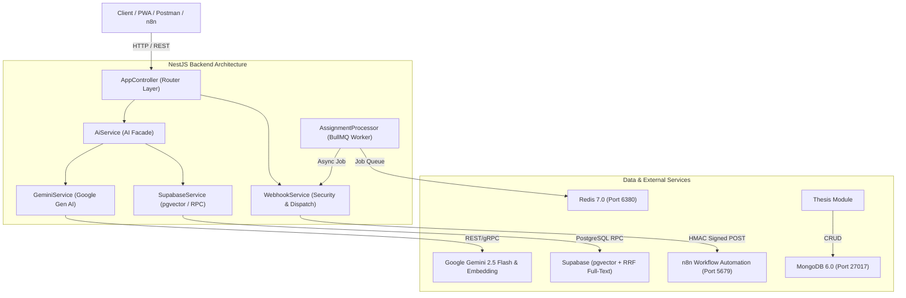

# BÁO CÁO TOÀN DIỆN VỀ KIẾN TRÚC, KHO MÃ NGUỒN VÀ KIỂM TOÁN HỆ THỐNG
**Dự án:** VKU AI Student Support System  
**Thời điểm kiểm toán:** 10/10/2026  
**Trạng thái tổng thể:** **SẴN SÀNG VẬN HÀNH (PRODUCTION-READY CHO CORE BACKEND & AI RAG)**

---

## 1. Tổng quan Kiến trúc & Công nghệ Đang hoạt động

### 1.1. Bảng công nghệ, SDK và thư viện chính

| Nhóm công nghệ | Thư viện / Công nghệ | Phiên bản (package.json) | Vai trò & Mục đích sử dụng |
| :--- | :--- | :--- | :--- |
| **Core Framework** | `@nestjs/core`, `@nestjs/common`, `@nestjs/platform-express` | `^12.0.1` | Khung ứng dụng backend kiến trúc module hóa hướng dịch vụ |
| **Config & DI** | `@nestjs/config` | `^12.0.1` | Quản lý biến môi trường toàn cục (`.env`) |
| **AI / LLM SDK** | `@google/genai` | `^2.28.0` | SDK chính thức của Google cho Gemini 2.5 Flash & Vector Embedding |
| **Vector DB** | `@supabase/supabase-js` | `^2.117.3` | Client kết nối Supabase PostgreSQL với tiện ích mở rộng `pgvector` |
| **CSDL Nghiệp vụ** | `@nestjs/mongoose`, `mongoose` | `^12.0.0` / `^9.10.4` | ODM quản lý dữ liệu đồ án tốt nghiệp và phân hệ sinh viên trên MongoDB |
| **Message Queue** | `@nestjs/bullmq`, `bullmq`, `ioredis` | `^12.0.0` / `^6.3.11` / `^6.0.0` | Hàng đợi tác vụ bất đồng bộ Redis xử lý tải nặng (AI evaluation) |
| **Security / Crypto** | Node.js `crypto` | Native Node module | Tạo và xác thực chữ ký số HMAC-SHA256 chống giả mạo webhook |
| **Hạ tầng Container**| Docker & Docker Compose | Docker Compose v2 | Điều phối 4 container: `vku-mongo`, `vku-redis`, `vku-pgvector`, `vku-n8n` |
| **Kiểm thử & Linter**| `oxlint`, `oxlint-tsgolint`, `jest`, `ts-jest` | `^1.58.0` / `^30.0.0` | Linter type-aware siêu tốc và test runner cho Unit/E2E test |

### 1.2. Kiến trúc phân tầng hiện tại



- **Controller Layer (`AppController`)**: Tiếp nhận request HTTP, kiểm tra sơ bộ input và điều phối đến các Service chuyên trách.
- **Service Layer**:
  - `AiService`: Đóng vai trò Facade tích hợp luồng RAG hoàn chỉnh (Hybrid Search RRF $\rightarrow$ Context Extraction $\rightarrow$ LLM Structured Output).
  - `GeminiService`: Quản lý vòng đời gọi model Gemini (sinh vector 768 chiều, ép kiểu JSON Schema theo `StructuredAiResponse`, tự động fallback phiên bản mô hình).
  - `SupabaseService`: Quản trị kết nối Supabase, thực thi hàm RPC `hybrid_search_rrf` và các truy vấn vector/bảng `documents`.
  - `WebhookService`: Ký bảo mật HMAC-SHA256, chuyển tiếp sự kiện sang n8n và xác thực chữ ký đến thông qua so sánh hằng số thời gian `timingSafeEqual`.
- **Background Jobs / Workers (`AssignmentProcessor`)**: Xử lý hàng đợi `submission-queue` qua BullMQ, chạy phân tích giả lập AI và tự động bắn webhook thông báo kết quả.

---

## 2. Danh mục Các Thành phần & Tính năng Đã Hoàn Thành

### 2.1. Backend Core & Database
- **Schemas & Entities MongoDB**:
  - Đã triển khai schema `Thesis` trong collection `theses`.
  - Áp dụng cấu trúc **Subdocument Pattern** với subdocument `Milestone`, có enum `MilestoneStatus` (`PENDING`, `IN_PROGRESS`, `COMPLETED`), trường `aiFeedback` và chỉ mục tìm kiếm trên `studentId`, `advisorId`.
- **Hàng đợi BullMQ & Redis**:
  - Module `AssignmentModule` đăng ký hàng đợi `submission-queue`.
  - Worker `AssignmentProcessor` xử lý bất đồng bộ các submission bài tập và tự động chuyển giao kết quả sang `WebhookService`.
- **Cấu hình Ứng dụng & Bảo mật Raw Body**:
  - Tại `src/main.ts`, NestJS được khởi tạo với cờ `rawBody: true` và body limit `10mb` nhằm bảo đảm dữ liệu buffer không bị biến đổi khi xác minh chữ ký HMAC.

### 2.2. AI Core & Vector Search (Supabase & Gemini)
- **Cấu hình Embeddings (`GeminiService`)**:
  - Model embedding chính: `gemini-embedding-001` (chuẩn 768 chiều).
  - Tích hợp cơ chế tự động phát hiện mã lỗi `404` / `NOT_FOUND` để fallback sang `text-embedding-004`.
- **Mô hình Dữ liệu & Chỉ mục pgvector (`supabase/migrations/20261009_hybrid_search_rrf.sql`)**:
  - Bảng `public.documents`: gồm `id` (uuid), `title` (text), `content` (text), `metadata` (jsonb), `embedding` (vector 768), `fts` (tsvector).
  - Cột `fts`: Sinh tự động (`GENERATED ALWAYS AS (to_tsvector('simple', title || ' ' || content)) STORED`).
  - Chỉ mục `documents_fts_idx`: Chỉ mục GIN phục vụ Full-Text Search.
  - Chỉ mục `documents_embedding_hnsw_idx`: Chỉ mục HNSW tối ưu hóa Vector Cosine Search (`vector_cosine_ops`).
- **Thuật toán Hybrid Search RRF**:
  - Hàm RPC PostgreSQL `public.hybrid_search_rrf` áp dụng kỹ thuật **Reciprocal Rank Fusion (RRF)**:
    $$\text{Score}_{\text{RRF}} = \frac{W_{\text{fts}}}{k + \text{Rank}_{\text{fts}}} + \frac{W_{\text{semantic}}}{k + \text{Rank}_{\text{semantic}}}$$
    với tham số mặc định $k = 60$, $W_{\text{fts}} = 1.0$, $W_{\text{semantic}} = 1.0$.
- **Cơ chế Structured Output (`GeminiService`)**:
  - Sử dụng model `gemini-2.5-flash` kèm `responseMimeType: 'application/json'` và `responseSchema` định nghĩa qua `Type` của `@google/genai`.
  - Cấu trúc phản hồi chuẩn xác gồm 5 trường:
    ```json
    {
      "answer": "string",
      "confidence_score": 0.0,
      "citations": ["string"],
      "requires_human_escalation": false,
      "suggested_actions": ["string"]
    }
    ```
  - **Escalation Logic**: Tự động đánh dấu `requires_human_escalation = true` nếu tài liệu không đủ dữ liệu trả lời HOẶC `confidence_score < 0.6`.
- **RAG Pipeline Hoàn chỉnh (`AiService.askAssistant`)**:
  - Nhận câu hỏi $\rightarrow$ Chạy `hybridSearch(question)` $\rightarrow$ Trích xuất context dạng `[Tiêu đề: ...]\nNội dung: ...` $\rightarrow$ Gửi prompt và context sang `GeminiService.generateStructuredResponse` $\rightarrow$ Trả về JSON chuẩn cho client.

### 2.3. Webhooks & n8n Integration
- **Dịch vụ Dispatch (`WebhookService.sendToN8n`)**:
  - Đóng gói dữ liệu và tự động sinh chữ ký bảo mật HMAC-SHA256 (`crypto.createHmac('sha256', secret)`).
  - Gửi POST request đến n8n workflow với các header:
    - `Content-Type: application/json`
    - `X-Signature: <hex_signature>`
    - `X-Event-Type: <event_name>` (ví dụ: `ASSIGNMENT_ANALYZED`, `TEST_EVENT`)
- **Xác thực Chữ ký (`WebhookService.verifySignature`)**:
  - Hỗ trợ đối chiếu chữ ký từ n8n gửi ngược lại sử dụng `crypto.timingSafeEqual` nhằm ngăn chặn tấn công Timing Attack.

---

## 3. Bảng Kiểm Thử & Tình trạng Vận hành (Verification Status)

### 3.1. Danh mục kịch bản kiểm thử hiện có

| File kiểm thử | Loại kiểm thử | Mục tiêu xác thực | Trạng thái |
| :--- | :--- | :--- | :--- |
| `src/app.controller.spec.ts` | Unit Test | Endpoint `/` (ping) và endpoint `POST /ai/ask` gọi `AiService` | **PASSED** |
| `src/modules/webhook/webhook.service.spec.ts` | Unit Test | Tạo chữ ký HMAC, cấu hình fetch headers, hàm xác thực chữ ký | **PASSED** |
| `src/modules/assignment/assignment.processor.spec.ts` | Unit Test | Worker xử lý job BullMQ và bắn webhook sự kiện | **PASSED** |
| `test/app.e2e-spec.ts` | E2E Test | Khởi động toàn bộ NestJS Application context và test HTTP GET `/` | **PASSED** |
| `scripts/verify-phase2-suite.ts` | Verification Suite | Tự động assert 4/4 tiêu chí Phase 2 (Embedding, RRF, 3A, 3B) | **PASSED** |
| `scripts/test-hybrid-search.ts` | Integration Script | Chạy độc lập kiểm thử kết nối Supabase và hàm RPC RRF | **PASSED** |
| `scripts/test-ask-assistant.ts` | Integration Script | Kiểm thử toàn trình pipeline RAG với câu hỏi trong & ngoài tài liệu | **PASSED** |

### 3.2. Bảng tổng hợp trạng thái thực thi lệnh

```bash
# 1. Trạng thái Unit Tests: 3/3 suites passed (6/6 tests)
$ npm test
PASS src/app.controller.spec.ts
PASS src/modules/assignment/assignment.processor.spec.ts
PASS src/modules/webhook/webhook.service.spec.ts
Test Suites: 3 passed, 3 total | Tests: 6 passed, 6 total

# 2. Trạng thái E2E Tests: 1/1 suite passed
$ npm run test:e2e
PASS test/app.e2e-spec.ts (1 passed, 1 total)

# 3. Trạng thái Static Analysis & Linter: 0 warnings, 0 errors
$ npm run lint (oxlint --type-aware src/ test/)
Found 0 warnings and 0 errors. Finished in 198ms on 20 files with 111 rules.

# 4. Trạng thái Biên dịch dự án: 100% Success
$ npm run build (nest build)
Compiles cleanly without TypeScript errors.

# 5. Kết quả chạy Suite tự động Phase 2:
$ npx ts-node scripts/verify-phase2-suite.ts
┌──────────────────────────────────────────────┬────────┐
│ Test Case                                    │ Status │
├──────────────────────────────────────────────┼────────┤
│ 1. Gemini Embedding (768-dim)                │ PASSED │
│ 2. Hybrid Search RRF Ranking                 │ PASSED │
│ 3A. Structured Output (In-domain)            │ PASSED │
│ 3B. Structured Output Escalation (Out-domain)│ PASSED │
└──────────────────────────────────────────────┴────────┘
✔ PHASE 2 VERIFICATION COMPLETE: Toàn bộ 4/4 kiểm thử đều PASSED thành công!
```

---

## 4. Danh mục API Endpoints Hiện Có

Tất cả các route hiện đang được định tuyến thông qua `AppController`:

| HTTP Method | URL Path | Request Body / Query Params | Mô tả chức năng | Định dạng phản hồi |
| :--- | :--- | :--- | :--- | :--- |
| `GET` | `/` | Không | Healthcheck endpoint kiểm tra ứng dụng đang hoạt động | `text/plain`: `"Hello World!"` |
| `POST` | `/test-webhook` | Không | Gửi payload giả lập sang n8n kèm chữ ký HMAC để kiểm tra liên thông workflow | `{"success": true, "message": "Webhook sent!", "dataSent": {...}}` |
| `GET` | `/test-hybrid-search` | Query: `?query=...` | Kiểm thử nhanh thuật toán Hybrid Search RRF qua URL query string | `{"success": true, "query": "...", "total": N, "data": [...]}` |
| `POST` | `/test-hybrid-search` | Body: `{"query": "..."}` | Thực hiện Hybrid Search RRF trên Supabase qua POST payload | `{"success": true, "query": "...", "total": N, "data": [...]}` |
| `POST` | `/ai/ask` | Body: `{"question": "..."}` | **Endpoint RAG chính:** Truy vấn câu hỏi học vụ, sinh phản hồi có cấu trúc JSON | Đối tượng JSON chuẩn `StructuredAiResponse` |

---

## 5. Khoảng trống (Gaps) & Các Hạng mục Tiếp Theo

### 5.1. Các khoảng trống so với kiến trúc hoàn chỉnh

1. **Chưa có Authentication & Authorization (Auth Guard)**:
   - Các endpoint (`/ai/ask`, `/test-webhook`,...) hiện mở public. Chưa có JWT Authentication hay phân quyền vai trò (Role-based access: Sinh viên, Giảng viên, Quản trị viên).
2. **Thiếu Document Ingestion API động**:
   - Hiện tại tài liệu tri thức trong bảng `public.documents` phải nạp qua script thủ công hoặc migrations SQL. Chưa có API cho phép cán bộ tải lên file PDF/DOCX (Quy chế tuyển sinh, học bổng, chuẩn đầu ra), tự động chunking và sinh vector lưu vào CSDL.
3. **Cơ chế Hội thoại Single-turn (Chưa có Conversation Session)**:
   - `askAssistant` hiện chỉ trả lời câu hỏi đơn lẻ độc lập, chưa lưu lại lịch sử tin nhắn nhiều lượt (`conversationId`, `sessionId`) vào MongoDB để duy trì ngữ cảnh trao đổi liên tục với sinh viên.
4. **Thiếu Inbound Webhook Receiver từ n8n**:
   - Hệ thống mới chỉ có luồng gửi đi (NestJS $\rightarrow$ n8n), chưa có Endpoint tiếp nhận kết quả trả về từ n8n (ví dụ: sau khi n8n chạy xong workflow chấm bài hoặc gửi email thông báo).
5. **Giao diện Người dùng (Frontend / PWA)**:
   - Hệ thống hiện tại thuần Backend API, chưa có giao diện Chatbot hoặc Dashboard cho sinh viên/giảng viên.
6. **Rate Limiting & Caching**:
   - Chưa tích hợp `@nestjs/throttler` để phòng chống spam DDOS vào API AI, và chưa cache kết quả tìm kiếm các câu hỏi lặp lại trên Redis.

---

### 5.2. Đề xuất 2 Bước Tiếp Theo Hợp Lý Nhất

Để phát triển dự án lên nấc thang tiếp theo một cách vững chắc, 2 tính năng nên được ưu tiên triển khai ngay:

#### 🎯 Bước 1: Xây dựng Ingestion Pipeline & Document Management API (Phase 3.1)
- **Mục tiêu**: Biến hệ sinh thái tri thức thành dạng động (Dynamic Knowledge Base).
- **Nội dung công việc**:
  1. Tạo `DocumentModule` với các endpoint REST: `POST /documents/upload` (hỗ trợ multipart upload PDF/Markdown) và `GET /documents`.
  2. Tích hợp pipeline tiền xử lý: Đọc file $\rightarrow$ Recursive Text Splitting (chunk size ~500-1000 tokens, overlap 100 tokens) $\rightarrow$ Tự động gọi `GeminiService.generateEmbedding` $\rightarrow$ Lưu hàng loạt vào bảng `documents` trên Supabase.
  3. Cung cấp API quản lý danh mục tài liệu học vụ theo khoa/ngành học.

#### 🎯 Bước 2: Triển khai Quản lý Phiên hội thoại (Multi-turn RAG) & Inbound Webhook từ n8n (Phase 3.2)
- **Mục tiêu**: Nâng cấp trải nghiệm trò chuyện liên tục và khép kín vòng lặp tự động hóa n8n.
- **Nội dung công việc**:
  1. Xây dựng Schema `Conversation` & `Message` trong MongoDB để lưu lại ngữ cảnh chat của sinh viên.
  2. Nâng cấp `askAssistant(question, conversationId)`: Tổng hợp ngữ cảnh 3-5 câu hỏi gần nhất trước khi tìm kiếm và phản hồi.
  3. Tạo controller `WebhookController` với endpoint `POST /webhooks/n8n/callback`: Nhận kết quả từ workflow n8n, tự động xác thực `X-Signature` qua `WebhookService.verifySignature` và cập nhật kết quả vào MongoDB.
