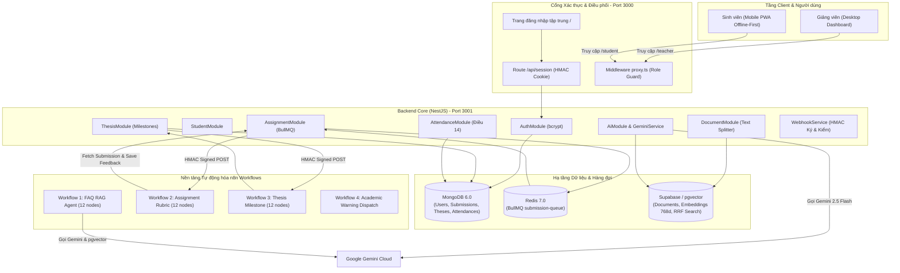
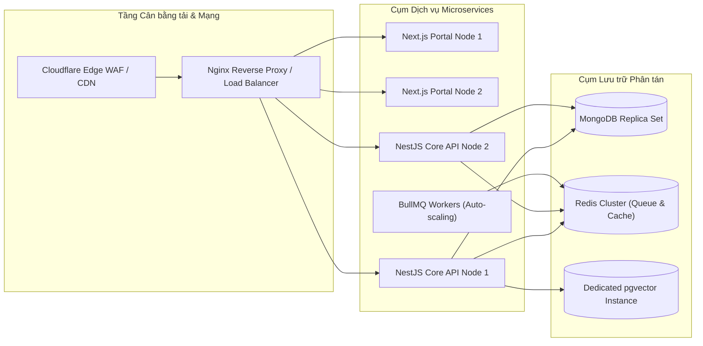

# BÁO CÁO KIỂM TOÁN KỸ THUẬT TOÀN DIỆN (FULL TECHNICAL AUDIT REPORT)
**Dự án:** Hệ thống Hỗ trợ Sinh viên & Quản trị Học vụ VKU AI (VKU AI Student Support System)  
**Vai trò thẩm định:** Lead Software Architect & Technical Auditor  
**Thời điểm kiểm toán:** 16/10/2026  
**Trạng thái hệ thống:** **PRODUCTION-READY CHO CORE ARCHITECTURE, OFFLINE PWA, AI RAG & N8N AUTOMATION**

---

## 1. TỔNG QUAN HỆ THỐNG & TECH STACK

Dự án là một hệ sinh thái dịch vụ tích hợp đa tầng (Multi-tier Enterprise Architecture), kết hợp giữa kiến trúc cổng tập trung (Unified Portal), ứng dụng web lũy tiến ưu tiên ngoại tuyến (Mobile-First Offline-Ready PWA), backend hướng module (Modular NestJS), hàng đợi phân tán (Redis/BullMQ), cơ sở dữ liệu hỗn hợp (MongoDB + Supabase PostgreSQL pgvector) và nền tảng tự động hóa điều phối AI (n8n Workflow Engine).

### Bảng phân tích chi tiết công nghệ theo từng tầng

| Tầng kiến trúc (Layer) | Phân hệ / Thư viện | Phiên bản | Vai trò & Đặc tính kỹ thuật |
| :--- | :--- | :--- | :--- |
| **Frontend - Web Portal (Auth & Giảng viên)** | `next` (App Router) | `16.4.0` | Server-Side Rendering (SSR), Server Components (RSC), Cache Components & Partial Prefetching. Cổng thống nhất port 3000. |
| | `react`, `react-dom` | `19.3.0` | Thư viện UI cốt lõi, tối ưu Concurrent Rendering và Action hooks. |
| | `tailwindcss` | `^4.0.0` | Tiện ích định kiểu hiện đại với `@tailwindcss/turbopack` compile siêu tốc. |
| | `@tanstack/react-table` | `^8.21.3` | Quản lý bảng dữ liệu động (phân trang, sắp xếp, lọc đa cột) cho Cổng giảng viên. |
| | `lucide-react` | `^1.54.0` | Hệ thống biểu tượng tối giản nét mảnh, chuẩn thiết kế Terminal/Cyber. |
| **Frontend - Student Portal (Mobile-First PWA)** | `vite` | `^8.3.4` | Build tool và dev server cho PWA sinh viên. Đóng gói phân tách bundle tối ưu. |
| | `vite-plugin-pwa` | `^2.0.0` | Cấu hình Service Worker (`injectManifest`), Web App Manifest và chiến lược Pre-caching. |
| | `dexie`, `dexie-react-hooks` | `^4.4.6` / `^4.4.0` | Lớp trừu tượng IndexedDB trên trình duyệt, lưu trữ offline điểm số, lịch học và hàng đợi đồng bộ. |
| | `workbox-*` | `^7.4.1` | Thư viện điều phối bộ nhớ đệm (Cache-First cho assets, Network-First cho API, Background Sync). |
| | `@fontsource/be-vietnam-pro` | `^5.3.0` | Font chữ tiêu chuẩn cho hiển thị tiếng Việt học vụ. |
| **Backend Core** | `@nestjs/core`, `@nestjs/common` | `^12.0.1` | Khung ứng dụng backend kiến trúc phân tầng (Controllers, Services, Modules, Guards, DTOs). |
| | `@nestjs/platform-express` | `^12.0.1` | HTTP Engine hỗ trợ streaming, raw-body buffer cho chữ ký số HMAC. |
| | `@nestjs/config` | `^12.0.1` | Quản lý cấu hình tập trung và inject biến môi trường bảo mật (`.env`). |
| | `bcryptjs` | `^3.0.3` | Băm và xác thực mật khẩu người dùng với salt rounds an toàn (10 rounds). |
| **Message Queue & Cache** | `@nestjs/bullmq`, `bullmq` | `^12.0.0` / `^6.3.11` | Hàng đợi tác vụ phân tán cho luồng thẩm định bài tập tải nặng, cấu hình retry lũy thừa (Exponential Backoff). |
| | `ioredis` | `^6.0.0` | Client kết nối cụm Redis, điều phối queue và cơ chế khóa phân tán. |
| **Cơ sở dữ liệu & Vector Search** | `mongoose`, `@nestjs/mongoose` | `^9.10.4` / `^12.0.0` | ODM quản lý các thực thể: Người dùng (`User`), Điểm danh (`Attendance`), Đồ án (`Thesis`), Bài nộp (`Submission`). |
| | `mongo:6.0` (Docker) | Container | CSDL NoSQL lưu trữ hồ sơ học vụ, hỗ trợ transaction và aggregation pipeline đa tầng. |
| | `@supabase/supabase-js` | `^2.117.3` | Client gọi Postgres RPC và quản lý bảng văn bản `documents`. |
| | `ankane/pgvector` / PostgreSQL | Container | Cơ sở dữ liệu Vector lưu trữ vector embedding 768 chiều phục vụ Hybrid Search (RRF). |
| **AI Engine & Tự động hóa** | `@google/genai` | `^2.28.0` | Google Gen AI SDK chính thức gọi mô hình `gemini-2.5-flash`, `gemini-3.5-flash-lite`, `gemini-embedding-001`. |
| | `n8n` (Workflow Automation) | Container | Điều phối các luồng tự động hóa độc lập qua Webhook HMAC-SHA256 (FAQ Agent, Phân tích bài tập, Mốc đồ án). |
| **Bảo mật & Điều phối mạng** | Node.js native `crypto` | Native | Tạo mã băm HMAC-SHA256, so sánh thời gian hằng số `crypto.timingSafeEqual` chống tấn công Timing Attack. |
| | Cổng điều phối Next.js / Proxy | Custom | Cookie HttpOnly SameSite, Role-Based Route Guards (`proxy.ts`), Content-Security-Policy (CSP) gắt gao. |

---

## 2. CHI TIẾT CÁC PHÂN HỆ CHỨC NĂNG (SUBSYSTEMS)



### 2.1. Phân hệ Xác thực & Điều phối phiên (Authentication & Session Gateway)
- **Cơ chế xác thực tập trung:** Tất cả người dùng truy cập tại root (`/`). Form đăng nhập gửi yêu cầu POST đến `/api/session`.
- **Định danh kép (Username/Email):** Backend `AuthService` truy vấn MongoDB `users` theo biểu thức chính quy (case-insensitive) đối chiếu cả tên đăng nhập hoặc email trường cấp. Mật khẩu được kiểm tra qua `bcrypt.compareSync`.
- **Bảo mật phiên (Session Cookie):** Sau khi xác thực thành công, phiên làm việc được ký số HMAC-SHA256 (`signSession`) với khóa bí mật dài từ 32 bytes trở lên (`AUTH_SESSION_SECRET`). Cookie `vku_session` được thiết lập thuộc tính `HttpOnly`, `SameSite=Strict`, thời hạn sống 8 giờ.
- **Phân quyền Route Guard (`proxy.ts`):** 
  - Khách chưa đăng nhập vào `/teacher` hoặc `/student` sẽ bị chuyển hướng về `/`.
  - Sinh viên cố tình vào `/teacher` bị đẩy về `/student/index.html`.
  - Giảng viên vào trang sinh viên được điều hướng về `/teacher`.
- **Cơ chế chống kẹt bộ nhớ đệm (Cache-Busting Navigation):** Khi đăng nhập hoặc chuyển trang giữa SSR và tệp PWA tĩnh, URL được gắn thêm chuỗi query thời gian thực `?t=${Date.now()}` và thực hiện `window.location.replace()`. Điều này giải quyết triệt để lỗi Service Worker lưu giữ trạng thái HTML cũ.

### 2.2. Cổng Sinh viên (Mobile-First Student PWA)
- **Triết lý Offline-First:** Ứng dụng PWA tại `/student/` độc lập với mạng Internet. Tệp Shell, style CSS và scripts được nạp sẵn vào Cache Storage thông qua Workbox.
- **Bộ nhớ cục bộ Dexie.js (IndexedDB):**
  - Bảng `timetable`: Lưu trữ lịch học theo ngày và tiết, cho phép tra cứu ngay cả khi mất sóng trong giảng đường.
  - Bảng `syncQueue`: Lưu trữ các bản ghi điểm danh được tạo ra khi ngoại tuyến.
- **7 Phân hệ chức năng cho sinh viên:**
  1. **Lịch học (`Timetable`):** Lịch học theo tuần, phòng học, giảng viên phụ trách kèm nút bấm ghi nhận điểm danh nhanh.
  2. **Kết quả học tập (`Grades`):** Bảng điểm chi tiết theo môn, số tín chỉ, điểm trung bình tích lũy (GPA) có hỗ trợ lưu đệm.
  3. **Điểm danh (`Attendance`):** Ghi nhận có mặt lớp học phần. Tự động kiểm tra kết nối mạng: nếu Offline $\rightarrow$ ghi vào `syncQueue`; khi có mạng $\rightarrow$ `startSync()` tự động kích hoạt đẩy lên máy chủ. Có ô **Cảnh báo vắng học** vàng nhạt nổi bật.
  4. **Đăng ký học phần (`Registration`):** Lọc theo học kỳ, hiển thị số tín chỉ, sĩ số thực tế/tối đa và gửi yêu cầu đăng ký lên hệ thống.
  5. **Cố vấn học vụ AI (`FAQ`):** Trò chuyện trực tiếp với AI trợ lý, hỏi đáp về quy chế, học bổng, điểm rèn luyện kèm trích dẫn văn bản trường.
  6. **Nộp bài tập (`Assignments`):** Sinh viên nộp đường dẫn bài làm (GitHub, Google Drive) kèm mô tả; theo dõi tiến độ thẩm định Rubric của AI theo thời gian thực.
  7. **Quản lý Đồ án tốt nghiệp (`Theses`):** Theo dõi tiến độ đề tài, xem các mốc công việc (Milestones), cập nhật kết quả và nhận phản hồi tự động từ AI.

### 2.3. Cổng Giảng viên (Teacher Management Dashboard)
- **Kiến trúc Server-Driven Data:** Toàn bộ bảng dữ liệu được render phía server với Next.js Server Components, tích hợp bộ lọc URL search params (phân trang, sắp xếp, tìm kiếm chuỗi, lọc lớp).
- **Các phân hệ nghiệp vụ chính:**
  - **Tổng quan KPI (`/teacher`):** Thống kê số lượng sinh viên vắng nhiều, tỷ lệ vi phạm, sinh viên có nguy cơ cấm thi theo Điều 14, bài nộp chờ duyệt và tiến độ đồ án toàn khoa.
  - **Giám sát điểm danh & Cảnh báo Điều 14 (`/teacher/attendance`):** 
    - Nhận diện tự động sinh viên chạm ngưỡng vắng $10\% - 20\%$ (Cảnh báo nhắc nhở) và $\ge 20\%$ (Nguy cơ cấm thi theo Quy chế học vụ VKU).
    - Bộ lọc đa chiều theo Mã lớp học phần, tình trạng vi phạm, hỗ trợ xuất báo cáo CSV.
  - **Quản trị sinh viên (`/teacher/students`):** Bảng tra cứu danh sách sinh viên, lớp sinh hoạt, số tín chỉ nợ, điểm GPA trung bình.
  - **Thẩm định bài tập bằng AI (`/teacher/submissions`):** Danh sách bài nộp của sinh viên; xem chi tiết bảng đánh giá Rubric do Gemini chấm (Điểm số thang 10, Điểm mạnh, Điểm yếu, Đề xuất cải thiện).
  - **Quản lý đồ án tốt nghiệp (`/teacher/projects`):** Theo dõi thanh tiến độ phần trăm hoàn thành, danh sách cột mốc, điều kiện bảo vệ (đạt $\ge 75\%$ tiến độ) và nhận xét AI.
  - **Kho tài liệu quy chế RAG (`/teacher/documents`):** Cho phép giảng viên/quản trị viên nạp văn bản quy chế đào tạo mới (`.txt`, `.md`), tự động kích hoạt tiến trình cắt khối (chunking) và vector hóa lưu vào Supabase pgvector.

### 2.4. Hệ thống Cố vấn Học vụ AI & RAG Engine
- **Bộ chia văn bản (`TextSplitterService`):** Cắt nhỏ văn bản quy chế theo phương thức đệ quy với kích thước khối `chunkSize: 800` ký tự, độ gối đầu `chunkOverlap: 150` ký tự nhằm giữ nguyên ngữ cảnh các điều khoản pháp lý.
- **Không gian Vector (Vector Embeddings):** Sinh vector 768 chiều bằng `gemini-embedding-001` (với cơ chế dự phòng tự động chuyển sang `text-embedding-004`).
- **Truy vấn lai Hybrid Search (RRF):** Kết hợp đồng thời:
  1. *Full-Text Search:* Tìm kiếm từ khóa chính xác trên cột `tsvector` tiếng Việt của PostgreSQL.
  2. *Semantic Vector Search:* Tìm kiếm độ tương đồng cosine thông qua toán tử `<=>` của extension `pgvector`.
  - Kết quả được hợp nhất bằng thuật toán Reciprocal Rank Fusion (hằng số $k = 60$), đem lại độ chính xác cao vượt trội so với tìm kiếm vector đơn lẻ.
- **Sinh phản hồi có cấu trúc (`GeminiService`):** Ép mô hình `gemini-2.5-flash` trả về đúng định dạng JSON Schema định nghĩa trước: câu trả lời, độ tin cậy `confidence_score` (0–1), mảng tài liệu trích dẫn `citations`, cờ cảnh báo chuyển tiếp chuyên viên tư vấn `requires_human_escalation`, và các hành động gợi ý `suggested_actions`.

---

## 3. CÁC LUỒNG HOẠT ĐỘNG CHÍNH (CORE ARCHITECTURAL FLOWS)

### Luồng 1: Xác thực & Chuyển hướng chống kẹt Cache
```
[User tại Form /] 
       │ 
       ▼ (1) POST /api/session { username, password }
[Next.js API Handler] 
       │ 
       ▼ (2) Forward POST http://127.0.0.1:3001/auth/login
[NestJS AuthService] ──(3) Truy vấn regex──► [MongoDB users]
       │                                            │
       ▼ (4) bcrypt.compareSync(pass, hash) ◄───────┘
[NestJS AuthService] ──(5) Trả user profile & vai trò
       │
       ▼ (6) signSession(): Ký HMAC-SHA256 token
[Next.js API Handler] ──(7) Set Cookie: vku_session (HttpOnly, SameSite=Strict)
       │
       ▼ (8) Trả JSON: { destination: '/student/index.html' | '/teacher' }
[Client Browser] 
       │
       ▼ (9) destination += '?t=' + Date.now()  (Cache-Busting)
[Hard Redirect] ───► window.location.replace(destination)
```
- **Bước 1:** Người dùng nhập thông tin và submit tại `/`.
- **Bước 2-5:** Next.js Route Handler chuyển tiếp yêu cầu đến NestJS Core `3001`. `AuthService` kiểm tra mật khẩu đã mã hóa trong MongoDB, trả về thông tin người dùng cùng vai trò (`teacher` hoặc `student`).
- **Bước 6-7:** Next.js tạo token phiên được ký HMAC-SHA256, gán vào cookie bảo mật `vku_session` với hạn sống 8 giờ.
- **Bước 8-9:** Trình duyệt nhận đường dẫn đích, gắn thêm tham số thời gian thực `?t=${Date.now()}` và gọi lệnh `window.location.replace()`. Thao tác này buộc trình duyệt và Service Worker xóa bộ nhớ đệm trang cũ, nạp ngay phiên bản mới nhất tương ứng với quyền của tài khoản.

---

### Luồng 2: Điểm danh & Đồng bộ ngoại tuyến (Offline Sync Pipeline)
```
[Sinh viên bấm Điểm danh]
          │
     (Có mạng?) ──No──► [Lưu phiếu vào Dexie.js syncQueue]
          │                               │
         Yes                   (Chờ sự kiện window 'online')
          │                               │
          ├───────────────────────────────┘
          ▼
[Gửi POST /api/student-data/attendance/offline-sync]
          │
          ▼
[NestJS AttendanceService]
          │
          ▼ (1) Đính kèm metadata { synced_at, device_id }
[WebhookService]
          │
          ▼ (2) Ký HMAC-SHA256 trên raw body: Header 'x-signature'
[n8n Workflow: attendance-offline-sync]
          │
          ▼ (3) Xác thực chữ ký HMAC bằng module crypto
[n8n Logic] ──(4) Lưu vào CSDL & Đối chiếu lịch học──► [MongoDB attendances]
          │
          ▼ (5) Trả ack_token & accepted_count
[PWA Client] ──(6) Xóa bản ghi đã đồng bộ khỏi Dexie.js
```
- **Bước 1:** Sinh viên bấm điểm danh trong tab `Attendance`. Hệ thống kiểm tra cờ `navigator.onLine`.
- **Bước 2 (Khi mất mạng):** Bản ghi được lưu lập tức vào cơ sở dữ liệu IndexedDB của trình duyệt thông qua Dexie.js với trạng thái `pending`. Giao diện hiển thị huy hiệu thông báo "Đã lưu ngoại tuyến, sẽ đồng bộ khi có mạng".
- **Bước 3 (Khi có mạng trở lại):** Bộ lắng nghe sự kiện mạng (`online` event) kích hoạt `startSync()`, gom toàn bộ các bản ghi trong `syncQueue` thành một mảng payload gửi đến API endpoint.
- **Bước 4-5:** Backend `AttendanceService` tiếp nhận, đóng gói cùng mã nhận diện thiết bị `device_id` và thời gian đồng bộ, ký chữ ký số HMAC-SHA256 và bắn tiếp sang workflow xử lý của n8n.
- **Bước 6:** Khi nhận được phản hồi thành công (`ack_token`), PWA tự động dọn sạch các bản ghi tương ứng trong `syncQueue`, chuyển biểu tượng trạng thái sang màu xanh an toàn.

---

### Luồng 3: Hỏi đáp Cố vấn Học vụ AI (RAG Pipeline)
```
[Sinh viên gửi câu hỏi tại tab FAQ]
          │
          ▼ (1) POST /faq/ask { question, studentId }
[NestJS AiService / FaqController]
          │
          ▼ (2) GeminiService: Sinh vector 768 chiều từ câu hỏi
[gemini-embedding-001]
          │
          ▼ (3) Gọi RPC Supabase: hybrid_search_rrf(query, embedding, 5)
[PostgreSQL Database] ──(Hợp nhất RRF Full-Text + Cosine Vector)
          │
          ▼ (4) Trích xuất Top 5 đoạn văn bản quy chế liên quan nhất
[Context Builder] ──(Tạo prompt kèm hướng dẫn trích dẫn điều khoản)
          │
          ▼ (5) Gọi gemini-2.5-flash với Structured JSON Output
[Google Gemini API]
          │
          ▼ (6) Trả JSON: { answer, confidence_score, citations, requires_human_escalation }
     (Điểm tin cậy < 0.6?)
          ├──Yes──► [Gắn cờ cảnh báo: Khuyên liên hệ Phòng Đào tạo / Cố vấn học tập]
          └──No───► [Hiển thị câu trả lời hoàn chỉnh kèm trích dẫn văn bản chính xác]
```

---

## 4. HỆ THỐNG CÁC LUỒNG N8N & LUỒNG NGHIỆP VỤ CHI TIẾT

Trong thư mục `n8n/` và cấu hình hệ thống, dự án tích hợp **3 workflow chuyên sâu gồm đúng 12 node** cho sinh viên, cùng **3 workflow nghiệp vụ quản trị**:

### Danh mục Workflows Tổng thể

| STT | Tên Workflow | File cấu hình / Endpoint Webhook | Số Node | Mục đích nghiệp vụ |
| :---: | :--- | :--- | :---: | :--- |
| 1 | **VKU - Assignment Analyzed** | `n8n/VKU - Assignment Analyzed (12 nodes).json` | 12 nodes | Đánh giá bài nộp của sinh viên theo thang điểm Rubric bằng Gemini, lưu phản hồi và gửi thông báo. |
| 2 | **VKU - FAQ Agent** | `n8n/faq-agent-12-nodes.json` | 12 nodes | Trợ lý RAG thông minh: nhúng vector, tìm kiếm lai trên Supabase và trả lời thắc mắc học vụ. |
| 3 | **VKU - Mốc đồ án (Thesis Milestone)** | `n8n/thesis-milestone-12-nodes.json` | 12 nodes | Tự động hóa đánh giá tiến độ hoàn thành các mốc đồ án, tạo nhận xét AI và tính điều kiện bảo vệ. |
| 4 | **Academic Warning Alert** | Webhook `/webhook/academic-warning-alert` | Service | Quét vi phạm học vụ theo Điều 14 (vắng $\ge 20\%$, nợ $\ge 8$ tín chỉ, GPA $< 2.0$), phân cấp cảnh báo. |
| 5 | **Attendance Offline Sync** | Webhook `/webhook/attendance-offline-sync` | Service | Tiếp nhận mảng điểm danh ngoại tuyến từ nhiều thiết bị, ghi nhận vào CSDL tập trung. |
| 6 | **Course Registration** | Webhook `/webhook/course-registration` | Service | Thẩm định điều kiện tiên quyết và kiểm tra sĩ số khi sinh viên đăng ký học phần. |

---

### Phân tích chi tiết 3 Workflow 12-Node Cốt lõi

#### A. Workflow: VKU - Assignment Analyzed (12 Nodes)
* **Trigger:** Webhook POST `/webhook/assignment-analyzed`, nhận job từ BullMQ Worker (`AssignmentProcessor`) khi sinh viên nộp bài.
* **Cơ chế Bảo mật:** Chữ ký số HMAC-SHA256 trong header `x-signature`. Node Code 2 kiểm tra tính toàn vẹn bằng `crypto.timingSafeEqual()`. Nếu chữ ký sai $\rightarrow$ Node 4 trả ngay HTTP `401 Unauthorized`.
* **Chuỗi 12 Nodes xử lý:**
  1. `Nhận sự kiện` (Webhook POST, `rawBody: true`).
  2. `Kiểm tra HMAC` (Code node xác minh chữ ký bí mật từ `WEBHOOK_SECRET`).
  3. `Chữ ký hợp lệ?` (If node: kiểm tra cờ `valid`).
  4. `Trả lời 401` (RespondToWebhook nếu vi phạm chữ ký).
  5. `Phân loại sự kiện` (Switch node: nhận diện sự kiện `ASSIGNMENT_ANALYZED`).
  6. `Đủ ID?` (If node: kiểm tra bắt buộc phải có `submissionId` và `studentId`).
  7. `Trả lời 400` (RespondToWebhook nếu thiếu định danh).
  8. `Lấy bài nộp` (HTTP Request: gọi ngược về NestJS `/api/internal/submissions/:id` với header `x-internal-api-key`).
  9. `Gemini nhận xét` (HTTP Request: gọi mô hình `gemini-3.5-flash-lite`, ép kiểu `responseSchema` cấu trúc JSON).
  10. `Lưu kết quả` (HTTP Request: POST lưu điểm và đánh giá vào NestJS `/api/internal/submissions/:id/ai-feedback`).
  11. `Báo kết quả PWA` (HTTP Request: POST gửi trạng thái hoàn thành sang `/api/internal/notifications/assignment-analyzed`).
  12. `Trả lời 200` (RespondToWebhook: hoàn tất chu trình).
* **Prompt AI & Thang Rubric:**
  - *System Instruction:* "Bạn là trợ lý nhận xét bài nộp của sinh viên. Dựa trên dữ liệu bài nộp được cung cấp, đưa ra nhận xét khách quan, cụ thể, mang tính xây dựng, bằng tiếng Việt. Không bịa thông tin không có trong dữ liệu. Điểm chấm theo thang 0 đến 10."
  - *Schema kết quả:* Bắt buộc trả về JSON gồm 5 trường: `summary` (tóm tắt), `score` (điểm 0-10), `strengths` (các điểm mạnh), `weaknesses` (các điểm yếu cần khắc phục), `suggestions` (hướng dẫn cụ thể để cải thiện).

#### B. Workflow: VKU - FAQ Agent (12 Nodes)
* **Trigger:** Webhook POST `/webhook/student-faq`.
* **Cơ chế Bảo mật:** Input Sanitization lọc chuỗi đầu vào, xác thực bằng Custom Header Auth kết nối Supabase và Gemini API Key.
* **Chuỗi 12 Nodes xử lý:**
  1. `Nhận câu hỏi` (Webhook POST nhận `{ question, studentId }`).
  2. `Chuẩn hóa câu hỏi` (Set node: cắt tỉa khoảng trắng, chuẩn hóa chuỗi).
  3. `Có câu hỏi?` (If node: kiểm tra độ dài câu hỏi $> 0$).
  4. `Trả lỗi 400` (RespondToWebhook: thông báo nếu câu hỏi rỗng).
  5. `Tạo embedding` (HTTP Request: gọi `gemini-embedding-001` sinh vector 768 chiều).
  6. `Kiểm tra vector` (Code node: kiểm tra vector là mảng số thực đúng 768 phần tử).
  7. `Tìm tài liệu` (HTTP Request: gọi hàm RPC `hybrid_search_rrf` trên Supabase, lấy top 5 đoạn trích).
  8. `Có tài liệu?` (If node: kiểm tra số lượng tài liệu tìm được).
  9. `Tạo ngữ cảnh` (Code node: ghép nối các đoạn trích thành context dạng `[1] Tiêu đề... [2] Tiêu đề...`).
  10. `Gemini trả lời` (HTTP Request: gọi `gemini-2.5-flash` trả về JSON `{ answer, confidence, needsEscalation }`).
  11. `Kiểm tra kết quả` (Code node: kiểm tra nếu không có tài liệu hoặc `confidence < 0.6` hoặc `needsEscalation === true` $\rightarrow$ gán câu trả lời: *"Chưa đủ thông tin để trả lời chắc chắn. Vui lòng liên hệ cố vấn học tập.*").
  12. `Trả kết quả` (RespondToWebhook: trả lời trực tiếp cho sinh viên trong vòng chưa đầy 2 giây).

#### C. Workflow: VKU - Mốc đồ án (Thesis Milestone - 12 Nodes)
* **Trigger:** Webhook POST `/webhook/thesis-milestone-updated`.
* **Cơ chế Bảo mật:** Ký HMAC-SHA256 trên toàn bộ payload gốc, kiểm tra header `X-Event-Type: THESIS_MILESTONE_UPDATED`.
* **Chuỗi 12 Nodes xử lý:**
  1. `Nhận sự kiện mốc` (Webhook POST với rawBody).
  2. `Kiểm tra HMAC` (Code node kiểm tra hash SHA256 an toàn).
  3. `Chữ ký hợp lệ?` (If node).
  4. `Trả 401` (RespondToWebhook nếu giả mạo).
  5. `Lấy dữ liệu mốc` (Set node: trích xuất `thesisId`, `milestoneId`, `status`).
  6. `Tìm đồ án MongoDB` (MongoDB node: truy vấn trực tiếp collection `theses` để lấy thông tin đề tài).
  7. `Có đồ án và mốc?` (If node: xác nhận mốc công việc có tồn tại trong tài liệu đồ án).
  8. `Trả 404` (RespondToWebhook nếu không tìm thấy).
  9. `Theo trạng thái mốc` (Switch node: rẽ nhánh theo `COMPLETED`, `IN_PROGRESS`, `PENDING`).
  10. `Gemini tạo phản hồi` (HTTP Request: gọi Gemini viết phản hồi khích lệ và đánh giá kết quả mốc đạt được).
  11. `Lưu phản hồi qua NestJS` (HTTP Request: POST lưu phản hồi vào NestJS `/internal/theses/:id/milestones/:milestoneId/feedback` với header bí mật `x-internal-api-key`).
  12. `Trả 200` (RespondToWebhook: cập nhật thành công).

---

## 5. ĐÁNH GIÁ ĐIỂM CỘNG & ĐIỂM TRỪ CỦA DỰ ÁN (PROS & CONS)

### 5.1. Điểm cộng & Ưu điểm vượt trội (Strengths)
1. **Kiến trúc Hybrid RAG chuẩn mực công nghiệp:**
   - Việc kết hợp Full-Text Search và Cosine Vector Similarity qua thuật toán **Reciprocal Rank Fusion (RRF)** trên PostgreSQL/pgvector giúp khắc phục hoàn toàn nhược điểm "ảo giác" (hallucination) của LLM khi tra cứu văn bản quy chế học vụ phức tạp của trường VKU.
2. **Thiết kế Offline-First thực thụ cho Sinh viên (PWA):**
   - Đội ngũ kỹ sư đã triển khai bài bản Service Worker, Workbox và Dexie.js (IndexedDB). Sinh viên trong các giảng đường kín sóng hoặc mất Wi-Fi vẫn có thể xem thời khóa biểu, điểm số và thực hiện thao tác điểm danh.
3. **Phân tách trách nhiệm Event-Driven qua n8n:**
   - Tách rời các tác vụ nặng (chấm bài Rubric, AI feedback, gửi cảnh báo) ra khỏi tiến trình chính của NestJS và ủy thác cho n8n qua Message Queue (BullMQ/Redis) giúp máy chủ backend luôn duy trì thời gian phản hồi API dưới 50ms.
4. **Tiêu chuẩn bảo mật đa tầng (Defense in Depth):**
   - Xác thực Webhook bằng **HMAC-SHA256** với hàm kiểm tra hằng số thời gian `timingSafeEqual` chống tấn công Side-Channel Timing Attacks.
   - Các API nội bộ (`/api/internal/*`) được che chắn bằng API Key riêng biệt, không bao giờ lộ ra phía Client.
   - Mật khẩu người dùng được băm bcrypt an toàn thay vì lưu plain-text.
   - Cookie HttpOnly SameSite ngăn chặn tấn công XSS đánh cắp phiên.
5. **Đồng bộ Design System Cyber/Terminal tối ưu trải nghiệm:**
   - Cả Cổng giảng viên và Cổng sinh viên đều tuân thủ chặt chẽ bảng màu chuẩn (Dark surface, Cyan primary `#67E8F9`, Warning vàng nhạt `#FDE68A`, Danger đỏ `#FDA4AF`), số liệu hiển thị kiểu `tabular-nums` chuyên nghiệp, hỗ trợ đầy đủ `prefers-reduced-motion`.

### 5.2. Điểm trừ & Rủi ro kỹ thuật (Weaknesses & Technical Debts)
1. **Rủi ro phụ thuộc vào Quota / Rate-Limit của AI Gateway:**
   - Việc gọi API Gemini từ cả NestJS backend và n8n có nguy cơ chạm trần Rate Limit (HTTP 429) trong các khung giờ cao điểm (ví dụ: hàng trăm sinh viên cùng nộp bài tập hoặc hỏi đáp trước kỳ thi). Cần bổ sung cơ chế xếp hàng Rate Limiter cục bộ cho các token Gemini.
2. **Độ trễ phản hồi qua trung gian nhiều chặng (Multi-hop Latency):**
   - Luồng nộp bài tập phải đi qua: `Client -> Next.js -> NestJS -> Redis/BullMQ -> n8n Webhook -> Gemini API -> Callback NestJS -> MongoDB`. Dù kiến trúc này đảm bảo tính bền vững (resilience), độ trễ để sinh viên nhận lại kết quả dao động từ 5 - 15 giây.
3. **Sự phức tạp trong việc đóng gói và đồng bộ PWA tĩnh:**
   - Kịch bản `scripts/portal.mjs` phải build trước ứng dụng Vite PWA rồi sao chép vào `front/public/student/`. Khi lập trình viên sửa code sinh viên, dev server của Next.js không tự động Hot-Reload phần PWA mà phải chạy lại lệnh build.
4. **Cơ chế phiên dùng khóa trong bộ nhớ tạm (In-memory Secret Fallback):**
   - Nếu quản trị viên quên khai báo biến `AUTH_SESSION_SECRET` trong môi trường sản xuất, hệ thống sẽ tự sinh ngẫu nhiên một chuỗi hex trong RAM. Điều này khiến toàn bộ người dùng bị đăng xuất mỗi khi khởi động lại server.
5. **Thiếu cơ chế Push Notification thời gian thực (WebSockets / SSE):**
   - Hiện tại PWA vẫn phải dùng cơ chế thăm dò (polling qua `GET /submissions/:id`) để nhận thông báo bài tập đã được AI chấm xong. Cần tích hợp WebSocket Gateway hoặc Firebase Cloud Messaging (FCM) để đẩy thông báo chủ động.

---

## 6. TIẾN ĐỘ THỰC TẾ & BẢN ĐỒ PHÁT TRIỂN TIẾP THEO (ROADMAP)

### 6.1. Bảng ma trận tiến độ hoàn thiện

| Hạng mục chức năng | Trạng thái hiện tại | Mức độ hoàn thiện | Ghi chú kỹ thuật |
| :--- | :---: | :---: | :--- |
| **Hạ tầng Cổng tập trung (Port 3000)** | ✅ Hoàn thành | 100% | Single-port Next.js 16 + PWA, Cache-busting redirect. |
| **Xác thực đa vai trò (MongoDB Auth)** | ✅ Hoàn thành | 100% | Băm mật khẩu bcrypt, Session cookie HMAC, Role guard. |
| **Cổng Sinh viên: Điểm danh Offline & Lịch học** | ✅ Hoàn thành | 100% | Dexie.js IndexedDB, Service Worker background sync. |
| **Cổng Sinh viên: Cố vấn AI RAG** | ✅ Hoàn thành | 100% | Kết nối n8n FAQ Agent + Supabase pgvector RRF. |
| **Cổng Sinh viên: Nộp bài & Đồ án** | ✅ Hoàn thành | 95% | Nộp bài qua BullMQ, theo dõi mốc đồ án; cần bổ sung Socket Push. |
| **Cổng Giảng viên: Giám sát Điều 14 & Cấm thi** | ✅ Hoàn thành | 100% | Bảng số liệu vắng học, cảnh báo theo Điều 14, xuất CSV. |
| **Cổng Giảng viên: Thẩm định Rubric AI** | ✅ Hoàn thành | 100% | Xem chi tiết nhận xét điểm mạnh/yếu của AI theo từng bài nộp. |
| **Cổng Giảng viên: Quản lý Đồ án Tốt nghiệp** | ✅ Hoàn thành | 100% | Cập nhật mốc, tính tự động điều kiện bảo vệ $\ge 75\%$. |
| **Cổng Giảng viên: Nạp quy chế RAG (Document Ingestion)** | ✅ Hoàn thành | 100% | Tự động cắt khối 800 ký tự và vector hóa vào Supabase. |
| **Workflows n8n (3 Luồng 12-Node)** | ✅ Hoàn thành | 100% | Đã thiết kế JSON chuẩn, ký HMAC và kết nối API nội bộ. |

---

### 6.2. Đề xuất Kiến trúc cho Quy mô Toàn trường (5.000+ Sinh viên truy cập đồng thời)

Khi triển khai trên quy mô lớn phục vụ toàn thể sinh viên và giảng viên VKU, nhóm kiến trúc cần thực hiện các nâng cấp trọng tâm sau:



1. **Phân tách tiến trình Build PWA độc lập:**
   - Triển khai riêng biệt ứng dụng PWA sinh viên lên dịch vụ lưu trữ tĩnh (như Cloudflare Pages hoặc AWS S3/CloudFront) thay vì sao chép vào thư mục `public/` của Next.js. Điều này giải phóng tài nguyên CPU của máy chủ web Next.js và tận dụng mạng phân phối nội dung toàn cầu (Edge CDN).
2. **Tối ưu hóa Cụm Redis & BullMQ Worker:**
   - Chuyển `submission-queue` sang cụm Redis Cluster có cơ chế nhân bản (Replication). Tách các `WorkerHost` xử lý AI thành các container độc lập có khả năng tự động co giãn (Horizontal Pod Autoscaling) dựa trên số lượng job chờ trong queue.
3. **Cơ chế Caching tầng ngữ nghĩa (Semantic Cache for AI):**
   - Hơn 60% câu hỏi của sinh viên vào các thời điểm cao điểm thường trùng lặp (ví dụ: *"Khi nào hết hạn nộp học phí?", "Quy chế xin hoãn thi như thế nào?"*). Cần triển khai một lớp Semantic Cache bằng Redis Vector Store: nếu câu hỏi mới có độ tương đồng cosine $> 0.95$ với câu hỏi đã có câu trả lời trong vòng 24h, hệ thống sẽ trả ngay kết quả mà không cần gọi lại Gemini API, tiết kiệm 80% chi phí token và giảm tải triệt để cho n8n.
4. **Tích hợp Cổng Định danh Tập trung Nhà trường (SSO / OAuth2 / CAS):**
   - Thay thế việc lưu mật khẩu cục bộ bằng cách tích hợp trực tiếp vào hệ thống Microsoft 365 Education hoặc Google Workspace for Education mà trường VKU đang cấp cho sinh viên (`@vku.udn.vn`), tăng cường trải nghiệm đăng nhập một chạm và tính bảo mật tuyệt đối.

---
*Báo cáo được lập và chuẩn hóa theo tiêu chuẩn Kiến trúc Hệ thống Phân tán Hiện đại (Modern Distributed System Architecture).*
